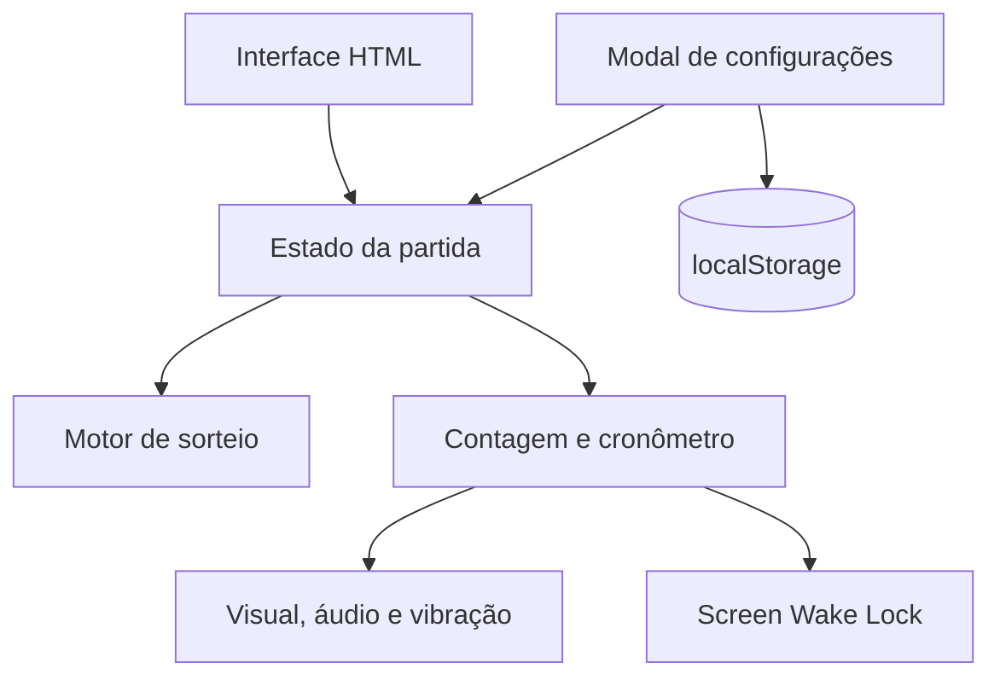
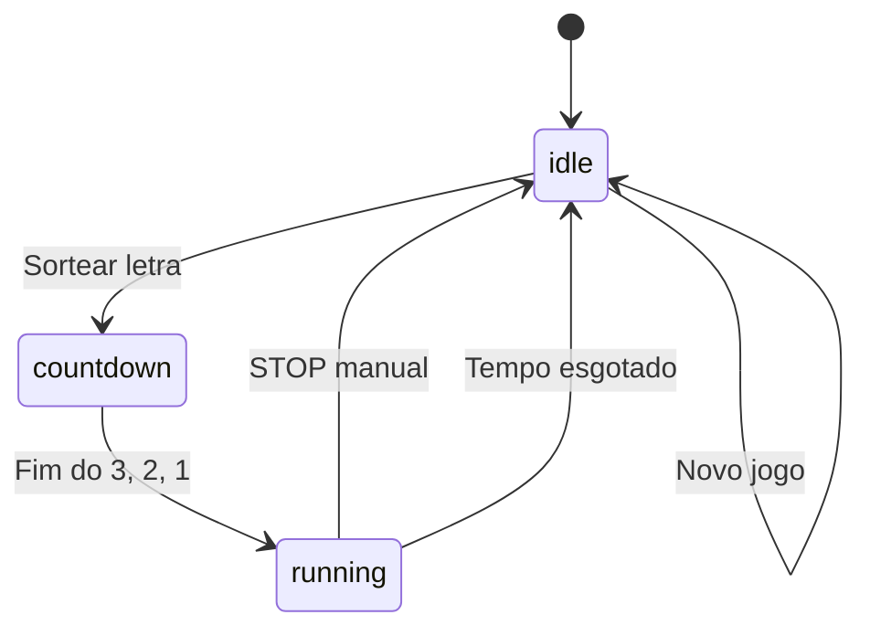

# Arquitetura

## Contexto

O STOP! é uma aplicação estática de página única. A decisão de concentrar estrutura, estilo e comportamento em `index.html` reduz o atrito de distribuição: basta copiar ou hospedar um arquivo.

## Restrições

- Sem framework ou biblioteca em tempo de execução.
- Sem build obrigatório.
- Sem backend, autenticação ou sincronização.
- Sem fontes, ícones, scripts ou APIs remotas.
- Compatibilidade progressiva com APIs opcionais do navegador.

## Visão dos componentes



Todos os componentes existem no mesmo documento, mas são separados por funções e responsabilidades.

## Máquina de estados



| Estado | Sorteio | Configuração | Novo jogo | Cartão da letra |
| --- | --- | --- | --- | --- |
| `idle` | Disponível se houver letras | Disponível | Disponível | Inativo |
| `countdown` | Oculto | Bloqueada | Bloqueado | Inativo |
| `running` | Oculto | Bloqueada | Exige confirmação se acionado | Encerra a rodada |

## Modelo de dados em memória

| Campo | Tipo | Responsabilidade |
| --- | --- | --- |
| `duracao` | número inteiro | Duração atual em segundos |
| `ativas` | lista de letras | Configuração da partida |
| `disponiveis` | lista de letras | Letras ainda sorteáveis |
| `usadas` | lista de letras | Histórico da partida |
| `fase` | string | `idle`, `countdown` ou `running` |
| `temp` | objeto | Edição ainda não salva do modal |

## Persistência

A chave `stop_cfg` armazena apenas preferências locais:

```json
{
  "tempo": 80,
  "letras": ["A", "B", "C"]
}
```

Na leitura:

- `tempo` precisa ser inteiro entre 5 e 999;
- `letras` precisa ser uma lista;
- cada item é filtrado pela lista fixa `A` a `Z`;
- configuração vazia ou inválida é substituída pelo padrão.

O histórico de letras usadas não é persistido. Recarregar a página inicia uma nova partida com as preferências salvas.

## Temporização

- A contagem regressiva usa `setTimeout` encadeado.
- A rodada usa `performance.now()` e `requestAnimationFrame`.
- O tempo restante deriva do instante final, evitando acumular erro por quantidade de quadros.
- Ao retornar para uma aba visível, o cálculo considera o tempo realmente transcorrido.

## Sorteio

O índice é escolhido com `Math.random()` no conjunto `disponiveis`. Isso é adequado para um jogo recreativo, mas não para sorteios com exigência criptográfica ou auditoria formal.

## Integrações do navegador

| API | Uso | Fallback |
| --- | --- | --- |
| Web Audio | Bipes e som final sintetizado | Jogo continua sem som |
| Vibration | Retorno tátil | Ignorado quando indisponível |
| Screen Wake Lock | Manter a tela ativa | O bloqueio natural do dispositivo permanece |
| localStorage | Salvar preferências | Padrões são usados na próxima abertura |

Todas as integrações são protegidas por detecção de suporte e tratamento de falhas.

## Segurança

- A Content Security Policy permite somente a própria origem e dados embutidos.
- Scripts e estilos inline são necessários para manter o requisito de arquivo único.
- Não há entrada de texto livre, cookies, tokens ou requisições de rede.
- Elementos dinâmicos usam `textContent` e criação explícita de nós.
- Não há `eval`, `new Function` ou execução de conteúdo persistido.
- O favicon é um SVG embutido e não dispara uma requisição externa.

## Acessibilidade

- Idioma da página definido como `pt-BR`.
- Controles com nomes acessíveis e estados `disabled`, `aria-pressed` e `aria-live`.
- Cartão da letra acionável por Enter e Espaço durante a rodada.
- Modal com retorno de foco, fechamento por Escape e contenção do Tab.
- Foco visível e suporte a `prefers-reduced-motion`.
- A informação de tempo não depende apenas da cor: há som nos segundos finais e mensagem textual no encerramento.

## Decisões principais

### Arquivo único

**Escolha:** manter HTML, CSS e JavaScript juntos.

**Benefícios:** distribuição simples, ausência de build e operação offline após salvar o arquivo.

**Custos:** arquivo maior, menor modularidade e necessidade de CSP com inline habilitado.

### Sem PWA nesta versão

**Escolha:** não referenciar `manifest` ou service worker inexistentes.

**Motivo:** preservar uma entrega válida e autônoma. Uma futura PWA deverá adicionar seus arquivos de maneira completa e versionada.

### Degradação progressiva

**Escolha:** áudio, vibração e Wake Lock são aprimoramentos, não pré-requisitos.

**Motivo:** manter a função essencial mesmo em navegadores restritivos, modo privado ou iPhone.
